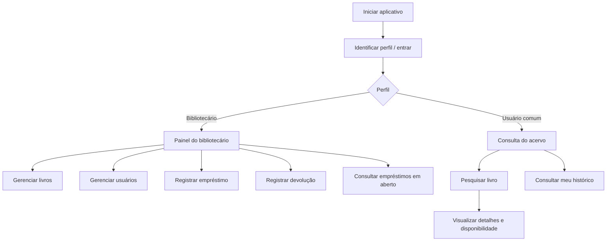

# Especificação funcional e fluxos de uso — AcervoVivo

**Projeto:** AcervoVivo — Sistema de Controle de Biblioteca  
**Curso:** Análise e Desenvolvimento de Sistemas — FASEC  
**Modalidade:** Projeto + Produto Computacional  
**Versão:** 0.1 — documento de trabalho para revisão  
**Data:** 02/11/2026  
**Situação:** elaborado a partir dos requisitos e da modelagem iniciais; ainda precisa ser validado.

---

## 1. Objetivo deste documento

Este documento transforma os requisitos gerais do AcervoVivo em uma descrição mais prática de como o sistema deverá ser utilizado. Ele detalha os perfis envolvidos, o caminho que cada pessoa percorre no aplicativo, as informações apresentadas nas telas, as regras de funcionamento e os critérios que serão usados para verificar se cada funcionalidade está correta.

A finalidade é orientar a próxima etapa do projeto: finalizar o protótipo das telas e, depois das decisões técnicas e acadêmicas necessárias, iniciar a implementação.

**Decisão de tecnologia:** o estudante informou em 13/11/2026 que o professor orientador autorizou a atualização da proposta para utilizar Flutter. O registro dessa decisão está em `docs/registro-de-decisao-flutter-2026-11-13.md`. A arquitetura de armazenamento, eventual API/backend e sincronização entre dispositivos continuam pendentes de definição.

## 2. Objetivo do produto

O AcervoVivo pretende apoiar a rotina de bibliotecas em geral, reunindo em um só lugar os dados dos livros físicos, dos usuários e dos empréstimos. O foco principal de utilização será em bibliotecas de escolas, faculdades e universidades, mas o sistema não será exclusivo desses ambientes. O mesmo conjunto de funções poderá atender outras bibliotecas que precisem organizar seu acervo e controlar a circulação de livros.

O sistema deverá ajudar a responder perguntas comuns da rotina da biblioteca:

- Quais livros estão cadastrados?
- Quantos exemplares existem de determinado livro?
- Quantos exemplares estão disponíveis?
- Quem está com um livro emprestado?
- Quando o empréstimo foi realizado?
- Qual é a data prevista para a devolução, caso a biblioteca adote um prazo?
- Quais empréstimos já foram encerrados?

O aplicativo não tem como objetivo disponibilizar arquivos PDF, oferecer leitura digital ou substituir a biblioteca por uma plataforma de e-books. A proposta atual é organizar o acervo físico e controlar a consulta, os empréstimos e as devoluções de livros. Em escolas e instituições de ensino superior, o usuário comum poderá representar alunos, professores e outros frequentadores; em outras bibliotecas, poderá representar leitores ou associados.

## 3. Pessoas que utilizarão o sistema

### 3.1 Bibliotecário

É a pessoa responsável pelo gerenciamento da biblioteca no aplicativo. Esse papel poderá existir em bibliotecas escolares, universitárias, públicas, comunitárias ou de outros tipos. Na proposta atual, poderá:

- cadastrar, consultar, alterar e excluir livros, respeitando as regras de integridade;
- cadastrar e consultar usuários;
- registrar empréstimos;
- registrar devoluções;
- consultar os empréstimos em aberto;
- consultar informações necessárias para acompanhar a disponibilidade dos livros.

### 3.2 Usuário comum

É a pessoa que consulta e utiliza o acervo. No cenário escolar e universitário, poderá ser aluno, professor ou outro frequentador autorizado; em outros ambientes, poderá ser leitor ou associado. Na proposta atual, poderá:

- consultar os livros cadastrados;
- pesquisar livros;
- visualizar informações do acervo;
- consultar o próprio histórico de empréstimos, depois de ser identificado pelo sistema.

O usuário comum não deverá ter acesso às funções administrativas de cadastro de livros, cadastro de usuários ou registro administrativo de empréstimos e devoluções.

### 3.3 Identificação e permissões ainda não definidas

A forma de login, o mecanismo de autenticação e a recuperação de acesso ainda não foram decididos. Por isso, este documento descreve os dois perfis como uma regra funcional pretendida, mas não determina ainda se o acesso será feito por e-mail, matrícula, senha ou outro método.

Antes de implementar o histórico pessoal, será necessário garantir que o sistema consiga identificar corretamente o usuário e impedir que uma pessoa consulte os dados de outra.

## 4. Escopo funcional da primeira versão

A primeira versão deverá priorizar as funções essenciais para organizar o acervo e acompanhar a circulação dos livros.

| Código | Funcionalidade | Perfil principal |
|---|---|---|
| F01 | Cadastrar livros | Bibliotecário |
| F02 | Consultar e pesquisar livros | Bibliotecário e usuário comum |
| F03 | Alterar dados de livros | Bibliotecário |
| F04 | Excluir livros conforme regras de integridade | Bibliotecário |
| F05 | Cadastrar usuários | Bibliotecário |
| F06 | Consultar usuários | Bibliotecário |
| F07 | Registrar empréstimos | Bibliotecário |
| F08 | Registrar devoluções | Bibliotecário |
| F09 | Consultar empréstimos em aberto | Bibliotecário |
| F10 | Consultar o próprio histórico | Usuário comum |

### 4.1 Itens que não estão confirmados para a primeira versão

Os itens abaixo foram discutidos como possibilidades, mas ainda não fazem parte do escopo aprovado nos documentos iniciais:

- reserva de livros pelo aluno;
- notificações automáticas ou lembretes de devolução;
- leitura ou download de livros em PDF;
- identificação de exemplares por QR Code;
- sincronização entre vários dispositivos ou unidades da biblioteca (a necessidade e a solução técnica ainda serão definidas na Issue #7).

Essas ideias só deverão entrar na primeira versão se forem avaliadas, aprovadas e incluídas formalmente nos requisitos e no planejamento. A prioridade é concluir bem as funções essenciais.

## 5. Fluxo geral de navegação

O fluxo abaixo representa a organização pretendida. A tela de acesso e a forma de identificação ainda dependem da decisão sobre autenticação.

## 6. Descrição funcional das telas

As telas abaixo são uma especificação de conteúdo e comportamento. Elas não significam que todos esses desenhos já existam no Figma.

### 6.1 Tela de acesso ou identificação

**Objetivo:** identificar a pessoa que está utilizando o aplicativo e determinar quais funções estarão disponíveis.

**Elementos previstos:**
- identificação ou seleção de perfil, conforme a solução aprovada;
- campos de acesso, caso seja adotado login;
- ação para entrar;
- mensagens de erro para dados inválidos.

**Regras:**
- o sistema deverá reconhecer o perfil associado à pessoa;
- o usuário comum não poderá abrir as funções administrativas;
- dados de acesso não poderão ser armazenados em texto puro caso seja adotada autenticação por senha.

**Pendente:** definir o mecanismo de autenticação e a forma de criação dos acessos.

### 6.2 Tela inicial

**Objetivo:** apresentar um ponto de entrada claro para as principais funções.

**Para o usuário comum:**
- campo de pesquisa;
- acesso ao catálogo;
- categorias ou filtros, se forem mantidos;
- atalho para o próprio histórico.

**Para o bibliotecário:**
- acesso ao gerenciamento de livros;
- acesso ao cadastro e consulta de usuários;
- atalho para registrar empréstimo;
- atalho para registrar devolução;
- acesso aos empréstimos em aberto.

A tela inicial já possui um primeiro desenho visual no Figma para o perfil de usuário comum. A versão administrativa ainda deverá ser desenhada.

### 6.3 Tela de catálogo e pesquisa

**Objetivo:** permitir localizar livros cadastrados.

**Informações apresentadas:**
- título;
- autor;
- categoria;
- indicação de disponibilidade, quando calculada pelo sistema.

**Comportamento esperado:**
1. A pessoa abre o catálogo.
2. Digita parte do título ou o nome do autor.
3. O sistema apresenta os resultados correspondentes.
4. Ao selecionar um livro, a pessoa visualiza seus detalhes e a disponibilidade.

**Critérios de aceitação:**
- a pesquisa deve localizar livros pelo título;
- a pesquisa deve localizar livros pelo autor;
- uma pesquisa sem resultado deve apresentar uma mensagem clara;
- a consulta não deverá permitir alterar os dados do livro pelo perfil comum.

### 6.4 Tela de detalhes do livro

**Objetivo:** apresentar as informações de uma obra selecionada.

**Informações previstas:**
- título;
- autor;
- ISBN, quando cadastrado;
- categoria;
- ano de publicação;
- editora;
- descrição;
- quantidade total de exemplares;
- quantidade disponível, calculada a partir dos empréstimos em aberto.

A exibição de quantidade total e disponível deverá ser revisada com o professor e com o responsável pela biblioteca, caso haja uma biblioteca real como referência para os testes.

### 6.5 Tela de cadastro e edição de livros

**Objetivo:** permitir que o bibliotecário mantenha o cadastro do acervo atualizado.

**Campos propostos:**
- título;
- autor;
- ISBN;
- categoria ou gênero;
- ano de publicação;
- quantidade de exemplares;
- editora;
- descrição ou sinopse.

**Validações iniciais sugeridas:**
- título não pode ficar vazio;
- autor não pode ficar vazio;
- quantidade de exemplares deve ser um número inteiro igual ou maior que zero;
- ano de publicação deve ser numérico e ter formato válido;
- ISBN deverá ser validado somente se a regra de obrigatoriedade for definida;
- campos opcionais deverão ser claramente identificados.

**Critérios de aceitação:**
- o bibliotecário consegue cadastrar um livro com os campos obrigatórios;
- o sistema informa quais campos precisam ser corrigidos;
- o livro cadastrado aparece no catálogo;
- alterações salvas são refletidas na consulta.

### 6.6 Tela de cadastro e consulta de usuários

**Objetivo:** manter o cadastro das pessoas que poderão utilizar os serviços da biblioteca.

**Campos atualmente propostos:**
- nome completo;
- e-mail;
- telefone;
- código ou matrícula;
- perfil;
- situação do cadastro.

**Validações a definir:**
- quais campos serão obrigatórios;
- se o e-mail será usado como identificador;
- se o e-mail deverá ser único;
- se a matrícula será necessária e única;
- quais valores de perfil serão aceitos;
- como será tratado um usuário inativo.

**Critérios de aceitação:**
- somente o perfil autorizado poderá cadastrar usuários;
- o cadastro deverá permitir consultar os dados posteriormente;
- os campos obrigatórios deverão ser validados;
- usuários inativos não deverão receber novos empréstimos, caso essa regra seja aprovada.

### 6.7 Tela de registro de empréstimo

**Objetivo:** registrar que um usuário recebeu um exemplar ou uma unidade de determinado título.

**Dados necessários:**
- livro selecionado;
- usuário selecionado;
- data do empréstimo;
- data prevista para devolução, se houver prazo definido.

**Fluxo proposto:**
1. O bibliotecário abre a função de empréstimo.
2. Seleciona o usuário.
3. Seleciona o livro.
4. O sistema verifica se existe disponibilidade.
5. O bibliotecário confirma o registro.
6. O sistema salva o empréstimo e atualiza a quantidade disponível.

**Regras propostas:**
- não permitir empréstimo sem livro cadastrado;
- não permitir empréstimo para usuário inexistente;
- não permitir empréstimo quando não houver exemplar disponível;
- não permitir empréstimo para cadastro inativo, caso a regra de situação seja aprovada;
- a data prevista não poderá ser anterior à data do empréstimo;
- o prazo e o limite de livros por usuário ainda precisam ser definidos.

**Critérios de aceitação:**
- o empréstimo salvo fica associado ao livro e ao usuário corretos;
- o registro aparece entre os empréstimos em aberto;
- a disponibilidade é reduzida de forma coerente;
- uma tentativa inválida apresenta mensagem compreensível.

### 6.8 Tela de devolução

**Objetivo:** encerrar um empréstimo que ainda está em aberto.

**Fluxo proposto:**
1. O bibliotecário consulta os empréstimos em aberto.
2. Localiza o empréstimo correspondente.
3. Confirma que o livro foi devolvido.
4. O sistema registra a data efetiva da devolução.
5. O empréstimo deixa de ser considerado em aberto.
6. A disponibilidade do livro é atualizada.

**Regras propostas:**
- somente empréstimos em aberto poderão ser encerrados;
- a data da devolução deverá ser registrada;
- o mesmo empréstimo não poderá ser devolvido duas vezes;
- o histórico do empréstimo deverá ser preservado.

**Critérios de aceitação:**
- o empréstimo encerrado não aparece mais como aberto;
- a data efetiva da devolução fica registrada;
- a disponibilidade aumenta corretamente;
- o histórico continua consultável.

### 6.9 Tela de empréstimos em aberto

**Objetivo:** ajudar o bibliotecário a acompanhar os livros que ainda não foram devolvidos.

**Informações previstas:**
- título do livro;
- usuário responsável;
- data do empréstimo;
- data prevista para devolução, se definida;
- situação do empréstimo.

A indicação de atraso só deverá ser implementada quando o prazo de empréstimo e a regra de cálculo estiverem definidos.

### 6.10 Tela de histórico do usuário

**Objetivo:** permitir que o usuário comum consulte os próprios empréstimos.

**Informações previstas:**
- livro emprestado;
- data do empréstimo;
- data prevista para devolução, quando adotada;
- data efetiva da devolução, quando registrada;
- situação atual ou final do empréstimo.

**Regra de privacidade:** o usuário comum só poderá consultar os empréstimos associados à própria identificação. A consulta administrativa poderá ter permissões diferentes, desde que isso seja definido no controle de acesso.

## 7. Regras de negócio consolidadas para revisão

As regras abaixo organizam as propostas já registradas na análise de requisitos e na modelagem. Elas ainda precisam ser validadas antes da implementação.

| Código | Regra proposta | Situação |
|---|---|---|
| RN01 | Cada empréstimo deve estar associado a um livro e a um usuário. | Proposta inicial |
| RN02 | Não pode haver empréstimo quando a disponibilidade for zero. | Proposta inicial |
| RN03 | A devolução deve encerrar um empréstimo em aberto. | Proposta inicial |
| RN04 | A data efetiva da devolução deve ser armazenada. | Proposta inicial |
| RN05 | O usuário comum só consulta o próprio histórico. | Proposta inicial |
| RN06 | O cadastro administrativo de livros e usuários fica com o bibliotecário. | Proposta inicial |
| RN07 | A exclusão de livro com empréstimo em aberto deve respeitar uma regra de integridade. | Decisão pendente |
| RN08 | O sistema pode indicar atrasos somente depois que o prazo for definido. | Decisão pendente |

## 8. Disponibilidade dos livros

A modelagem inicial considera armazenar a quantidade total de exemplares de cada livro e calcular a disponibilidade descontando os empréstimos ainda não devolvidos.

**Fórmula proposta:**

`Disponíveis = quantidade total de exemplares - empréstimos em aberto`

**Exemplo:** se a biblioteca possui 5 exemplares cadastrados e existem 2 empréstimos em aberto para aquele título, o sistema deverá mostrar 3 exemplares disponíveis.

Essa regra precisa ser protegida contra inconsistências. O sistema deverá impedir que dois registros simultâneos ou operações repetidas provoquem uma quantidade disponível negativa.

**Decisão ainda pendente:** confirmar se a biblioteca precisa controlar cada exemplar físico individualmente. Se cada cópia tiver identificação própria, o modelo de dados deverá ser ampliado com uma entidade específica de exemplar.

## 9. Validações de dados

As validações abaixo são uma proposta inicial para orientar os formulários e os testes. Não representam regras finais aprovadas.

| Informação | Validação proposta |
|---|---|
| Título | Obrigatório e não pode conter apenas espaços. |
| Autor | Obrigatório e não pode conter apenas espaços. |
| Quantidade de exemplares | Número inteiro maior ou igual a zero. |
| Ano de publicação | Número em formato de ano; limites finais a definir. |
| ISBN | Formato a validar se for utilizado na primeira versão. |
| Nome do usuário | Obrigatório e não pode conter apenas espaços. |
| E-mail | Validar formato se o campo for adotado. |
| Matrícula | Definir formato e unicidade, se for utilizada. |
| Data do empréstimo | Deve ser uma data válida. |
| Data prevista | Não pode anteceder a data do empréstimo. |
| Data de devolução | Só deve ser preenchida ao encerrar o empréstimo. |

Mensagens de validação devem informar o problema e orientar a correção, evitando mensagens técnicas difíceis de entender.

## 10. Cenários de teste planejados

Os cenários a seguir serão utilizados quando as funções forem implementadas.

| ID | Cenário | Resultado esperado |
|---|---|---|
| CT01 | Cadastrar livro com dados válidos | Livro salvo e exibido no catálogo |
| CT02 | Tentar cadastrar livro sem título | Sistema solicita correção |
| CT03 | Pesquisar por título existente | Livro correspondente aparece |
| CT04 | Pesquisar por autor existente | Livros daquele autor aparecem |
| CT05 | Consultar livro sem disponibilidade | Sistema informa que não há exemplar disponível |
| CT06 | Registrar empréstimo com exemplar disponível | Empréstimo salvo e disponibilidade reduzida |
| CT07 | Tentar emprestar sem exemplar disponível | Operação bloqueada com mensagem |
| CT08 | Registrar devolução de empréstimo aberto | Empréstimo encerrado e disponibilidade atualizada |
| CT09 | Tentar devolver empréstimo já encerrado | Operação bloqueada ou informada como já concluída |
| CT10 | Usuário comum consultar histórico próprio | Apenas os registros associados a ele são exibidos |
| CT11 | Usuário comum tentar acessar cadastro administrativo | Acesso negado |
| CT12 | Fechar e abrir o aplicativo | Dados persistem, conforme a solução de armazenamento aprovada |

## 11. Critérios gerais para considerar uma funcionalidade concluída

Uma função não deverá ser considerada pronta apenas porque a tela foi desenhada. Para cada funcionalidade, será necessário:

1. ter os requisitos e as regras definidos;
2. possuir uma tela implementada;
3. executar a operação esperada;
4. validar os dados de entrada;
5. tratar situações de erro;
6. persistir ou recuperar os dados conforme a arquitetura aprovada;
7. realizar testes com cenários válidos e inválidos;
8. registrar o resultado e corrigir problemas identificados.

## 12. Ordem recomendada para implementação

A sequência abaixo considera as dependências entre as funcionalidades.

| Ordem | Atividade | Dependência |
|---|---|---|
| 1 | Validar o escopo com o professor | Orientação acadêmica |
| 2 | Definir perfis, identificação e permissões | Decisão de acesso |
| 3 | Definir armazenamento e sincronização | Necessidade de uso em um ou mais dispositivos |
| 4 | Fechar campos e regras de negócio | Revisão de requisitos |
| 5 | Finalizar fluxo e telas no Figma | Requisitos e perfis |
| 6 | Criar estrutura Flutter e camada de dados | Plataforma e armazenamento aprovados |
| 7 | Implementar cadastro e consulta de livros | Banco de dados |
| 8 | Implementar cadastro e consulta de usuários | Regras de acesso |
| 9 | Implementar empréstimos e devoluções | Livros, usuários e regras de prazo |
| 10 | Implementar histórico | Identificação e empréstimos |
| 11 | Testar e corrigir | Funcionalidades implementadas |
| 12 | Atualizar documentação e preparar entrega | Testes e evidências |

## 13. Decisões que ainda precisam ser tomadas

Antes de fechar a especificação para implementação, é necessário responder:

- A autorização para utilizar Flutter foi comunicada pelo estudante em 13/11/2026 e está registrada em `docs/registro-de-decisao-flutter-2026-11-13.md`.
- O aplicativo será utilizado em apenas um dispositivo ou em vários dispositivos da biblioteca?
- O armazenamento local será suficiente ou será necessário sincronizar os dados?
- Como será feito o login e como serão separados os dois perfis?
- Quais campos de usuário serão obrigatórios?
- Qual será o prazo dos empréstimos?
- Haverá limite de livros emprestados por usuário?
- Será permitida renovação?
- Como o sistema tratará atrasos?
- O controle será por quantidade de exemplares ou por cada exemplar individual?
- A reserva de livros fará parte da primeira versão ou ficará para uma versão futura?

As respostas deverão ser registradas e utilizadas para atualizar os documentos de requisitos, modelagem e planejamento.

## 14. Relação com a documentação existente

Esta especificação complementa os materiais já disponíveis no repositório:

- [Análise de requisitos](analise-de-requisitos.md): apresenta o problema, os objetivos, os requisitos e as regras iniciais.
- [Modelagem inicial do banco de dados](modelagem-banco-de-dados.md): descreve as entidades Livro, Usuário e Empréstimo e seus relacionamentos.
- [Planejamento do projeto](planejamento-do-projeto.md): apresenta as tecnologias em consideração, as telas previstas e a ordem inicial de execução.
- [Kanban do AcervoVivo](../KANBAN.md): acompanha as tarefas e as próximas etapas.

## 15. Resultado desta etapa documental

Com esta especificação, o projeto passa a ter uma descrição mais detalhada de como as pessoas deverão utilizar o aplicativo, quais informações cada tela deverá apresentar, quais regras precisam ser respeitadas e como o funcionamento será testado.

O documento também identifica decisões que não devem ser inventadas durante a programação. Elas precisam ser discutidas e registradas antes de serem transformadas em código.

**Esta é uma versão de trabalho para revisão.** A autorização para utilizar Flutter foi comunicada pelo estudante em 13/11/2026 e registrada em documento próprio. A especificação ainda depende da definição de autenticação, regras de empréstimo, modelo de exemplares e arquitetura de armazenamento; ela não comprova que banco de dados ou funcionalidades estejam implementados.
