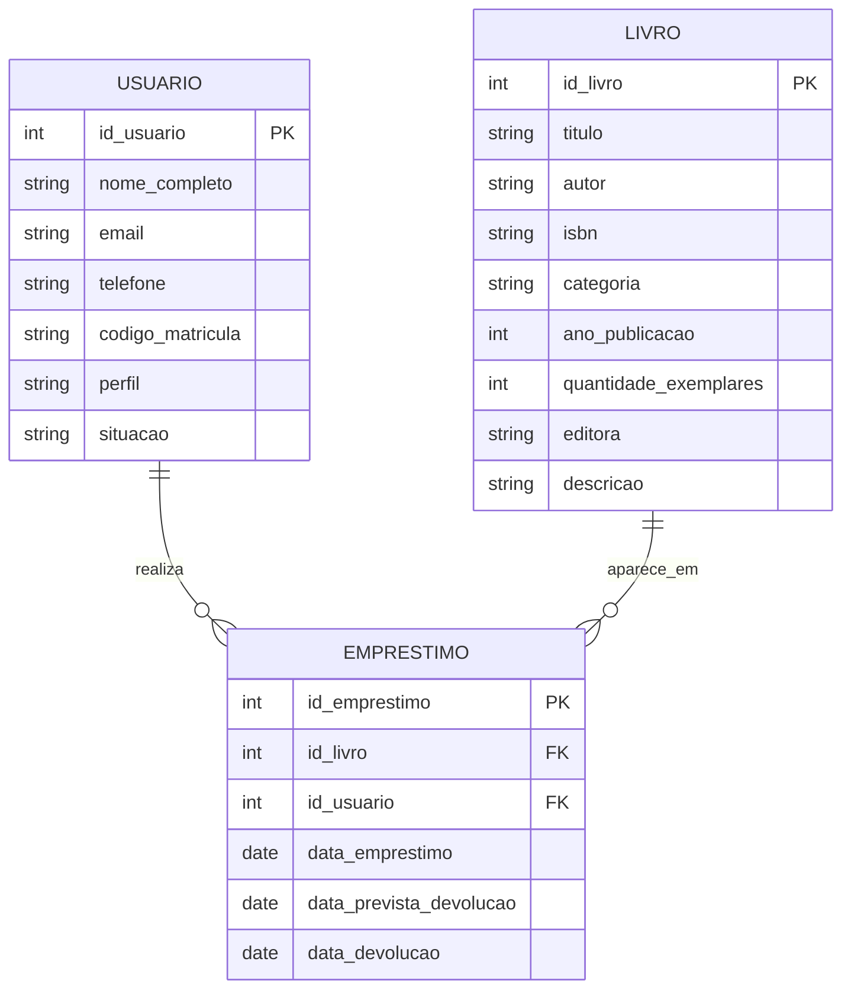

# Modelagem inicial do banco de dados — AcervoVivo

**Projeto:** Sistema de Controle de Biblioteca  
**Curso:** Análise e Desenvolvimento de Sistemas — FASEC  
**Modalidade:** Projeto + Produto Computacional  
**Versão:** 1.0 — proposta inicial  
**Data:** 20/10/2026

## 1. Objetivo

Este documento apresenta uma primeira proposta de organização dos dados do AcervoVivo. A ideia é identificar quais informações o sistema precisa guardar e como os livros, os usuários e os empréstimos se relacionam.

Esta é uma modelagem inicial. Os campos e as regras ainda podem ser ajustados depois da revisão dos requisitos e da confirmação da plataforma com o professor orientador.

## 2. Entidades principais

Para começar, propomos três entidades: **Livro**, **Usuário** e **Empréstimo**.

### 2.1 Livro

Guarda os dados de cada obra cadastrada na biblioteca.

| Campo proposto | Finalidade | Observação |
|---|---|---|
| id_livro | Identificar cada registro de livro. | Chave primária; gerada pelo sistema. |
| titulo | Guardar o título da obra. | Campo proposto no levantamento. |
| autor | Guardar o nome do autor ou autores. | Campo proposto no levantamento. |
| isbn | Guardar o ISBN da edição, quando houver. | Confirmar validação e obrigatoriedade. |
| categoria | Classificar a obra por categoria ou gênero. | Campo proposto no levantamento. |
| ano_publicacao | Guardar o ano de publicação. | Confirmar validação. |
| quantidade_exemplares | Registrar quantos exemplares a biblioteca possui. | Deve ser um número inteiro não negativo. |
| editora | Guardar o nome da editora. | Campo proposto no levantamento. |
| descricao | Guardar a sinopse ou descrição da obra. | Campo proposto no levantamento. |

### 2.2 Usuário

Guarda as informações das pessoas cadastradas. A proposta considera dois perfis: bibliotecário e usuário comum.

| Campo proposto | Finalidade | Observação |
|---|---|---|
| id_usuario | Identificar cada usuário. | Chave primária; gerada pelo sistema. |
| nome_completo | Guardar o nome da pessoa. | Proposto para o cadastro. |
| email | Guardar o e-mail de contato. | Confirmar se será usado para login e se deverá ser único. |
| telefone | Guardar telefone de contato. | Opcional, se for necessário. |
| codigo_matricula | Guardar um código interno da biblioteca. | Confirmar se será necessário. |
| perfil | Distinguir bibliotecário e usuário comum. | Necessário para separar permissões; validar na revisão. |
| situacao | Indicar se o cadastro está ativo ou inativo. | Proposto; confirmar se será utilizado. |

A forma de autenticação ainda não foi definida. Como o usuário comum deverá consultar seu próprio histórico, será necessário decidir como o sistema identificará a pessoa antes de permitir esse acesso. Não armazenar senhas em texto puro; se houver senha, a implementação deverá guardar um hash seguro, após a escolha e validação do mecanismo de login.

### 2.3 Empréstimo

Registra cada empréstimo realizado e sua devolução.

| Campo proposto | Finalidade | Observação |
|---|---|---|
| id_emprestimo | Identificar cada empréstimo. | Chave primária; gerada pelo sistema. |
| id_livro | Identificar qual livro foi emprestado. | Chave estrangeira para Livro. |
| id_usuario | Identificar quem pegou o livro. | Chave estrangeira para Usuário. |
| data_emprestimo | Registrar quando o empréstimo ocorreu. | Parte do registro do empréstimo. |
| data_prevista_devolucao | Guardar a data prevista para devolução. | A regra de prazo ainda precisa ser decidida. |
| data_devolucao | Guardar a data em que o livro foi devolvido. | Pode ficar vazia enquanto o livro estiver emprestado. |

Nesta proposta, cada registro de empréstimo corresponde a um livro e a um usuário. Caso seja necessário permitir vários livros em uma única operação de empréstimo, o modelo precisará ser ampliado.

## 3. Relacionamentos

- Um **usuário** pode ter vários empréstimos ao longo do tempo.
- Um **livro** pode aparecer em vários empréstimos ao longo do tempo.
- Cada registro de **empréstimo** está associado a um único usuário e a um único livro.

### Diagrama inicial

## 4. Como controlar a disponibilidade

Para manter a primeira versão simples, a proposta é registrar em Livro a quantidade total de exemplares e calcular a disponibilidade contando quantos empréstimos ainda não foram devolvidos.

**Disponíveis = quantidade total de exemplares − empréstimos ainda em aberto daquele livro.**

Exemplo: se a biblioteca tem 5 exemplares e 2 deles estão emprestados, o sistema mostraria 3 disponíveis. Essa regra precisa ser implementada com cuidado para não permitir empréstimos além da quantidade disponível.

Esse modelo controla exemplares por quantidade. Se o projeto precisar identificar cada cópia individualmente, será necessário criar uma entidade separada para os exemplares. Essa decisão ainda está pendente.

## 5. Regras de integridade propostas

As seguintes regras deverão ser consideradas ao desenvolver e testar o banco de dados:

- Cada livro, usuário e empréstimo deve ter um identificador próprio.
- Um empréstimo deve referenciar um livro existente e um usuário existente.
- A quantidade total de exemplares não pode ser negativa.
- Um empréstimo não pode ser registrado quando não houver exemplar disponível.
- A data de devolução deve ficar vazia enquanto o empréstimo não for encerrado.
- O histórico deve permitir identificar quais empréstimos pertencem a cada usuário.
- A exclusão de livros com empréstimos relacionados precisa de uma regra específica; uma alternativa é bloquear a exclusão enquanto houver empréstimo em aberto.

Essas são propostas técnicas iniciais, não regras já aprovadas pelo professor. Elas deverão ser revisadas junto com o restante dos requisitos.

## 6. Decisões ainda pendentes

Antes de criar o banco de dados definitivo, precisamos confirmar ou decidir:

1. Se o sistema será web com FastAPI e SQLAlchemy ou se a interface será desenvolvida em Flutter.
2. Como funcionará o login e como serão diferenciados os perfis.
3. Se o e-mail será único e se o código ou matrícula será necessário.
4. Qual será o prazo dos empréstimos e como será registrada a data prevista de devolução.
5. Se o sistema controlará apenas a quantidade de exemplares ou cada exemplar individualmente.
6. Como lidar com a exclusão de livros que já possuem histórico de empréstimos.

## 7. Próximas atividades

Depois de validar esta proposta, o próximo passo será revisar os campos e relacionamentos e, em seguida, preparar o modelo físico do banco de dados na tecnologia escolhida. Só depois disso faz sentido criar as tabelas e começar a ligar o banco às funcionalidades do sistema.

**Observação sobre o estágio:** este documento registra o trabalho de modelagem realizado, mas não substitui o registro oficial das horas. As horas devem ser anotadas de acordo com o tempo efetivamente dedicado à atividade, conforme as orientações da FASEC.
